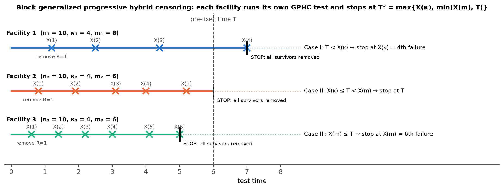
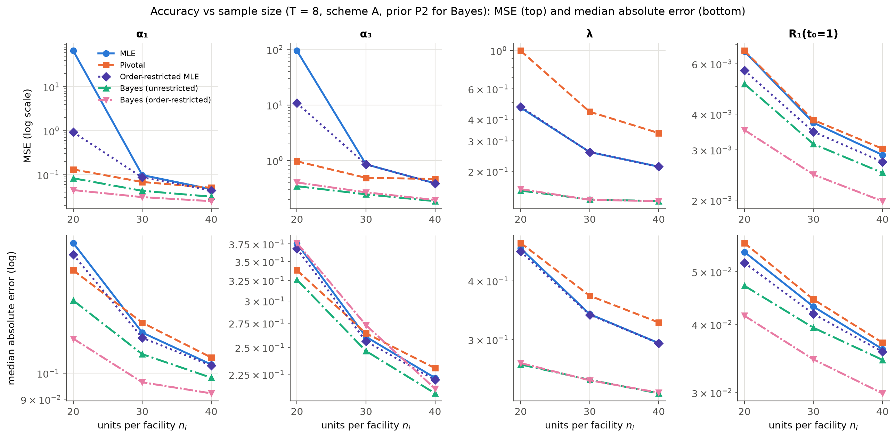
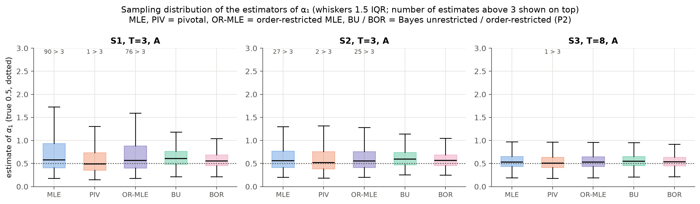
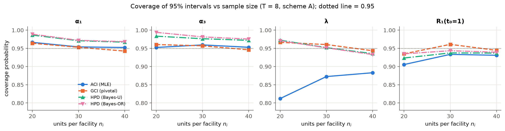
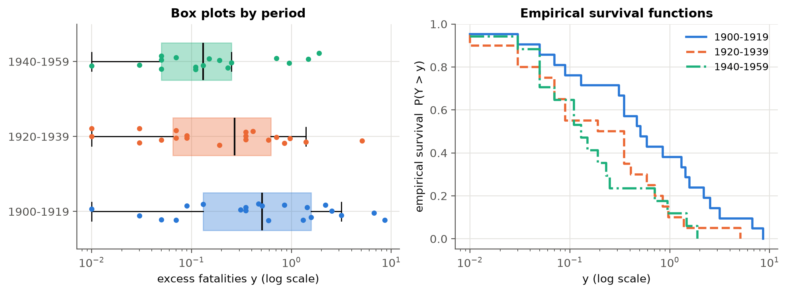
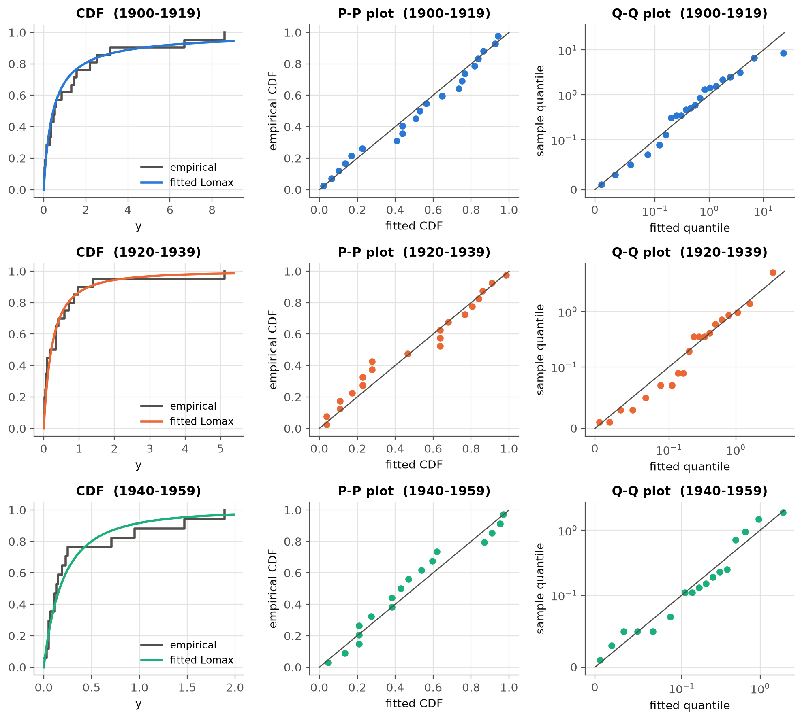
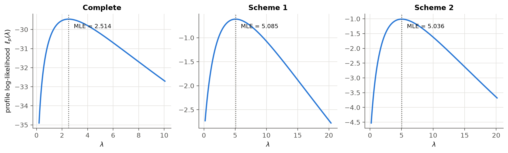
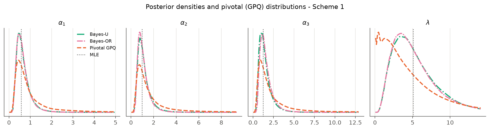
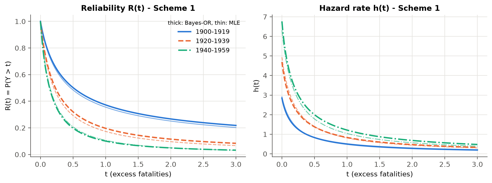

# Abstract {.unnumbered}

Life tests are often run in several test facilities at the same time, and they are usually stopped before every unit fails. This project studies **block generalized progressive hybrid censoring (BGPHC)**. A total of $n$ units is split into $k$ blocks. Each block is tested in its own facility under a generalized progressive hybrid censoring scheme, which guarantees a minimum number of failures while keeping the test time under control. We assume that the lifetime of a unit tested in facility $i$ follows a **Lomax** (Pareto type II) distribution with a facility-specific shape $\alpha_i$ and a common scale-type parameter $\lambda$, so the $\alpha_i$'s measure the *difference between test facilities*.

We derive the likelihood and four families of estimators:

* maximum likelihood estimators (MLEs), with a sufficient condition for existence and asymptotic confidence intervals from the observed Fisher information and the delta method;
* pivotal-quantity (generalized pivotal) estimators and generalized confidence intervals. We prove that the Lomax pivot for $\lambda$ is strictly *decreasing* and bounded, and handle this by a truncation step;
* Bayes estimators under squared-error and LINEX loss with a **joint (dependent) Gamma–Dirichlet prior**, computed by importance sampling, with HPD credible intervals;
* **order-restricted** MLEs (isotonic regression) and order-restricted Bayes estimators (ordered Gamma–Dirichlet prior) for $\alpha_1\le\alpha_2\le\dots\le\alpha_k$.

A Monte Carlo study covers 18 designs with 2,000 replications each. The MLE of the shape parameters is unstable in small or short tests. The pivotal method gives the most reliable frequentist intervals: its coverage is close to 95%, while the MLE intervals for $\lambda$ under-cover at 81–90%. The order-restricted Bayes estimator has the smallest errors overall. The methods are applied to excess fatalities in British coal-mining disasters in three 20-year periods. Lomax fits every period, a common $\lambda$ is supported (LRT $p = 0.65$), and the shape increases over time. This is consistent with the order restriction: catastrophic disasters became rarer.

**Keywords:** Lomax distribution; block censoring; generalized progressive hybrid censoring; maximum likelihood; generalized pivotal quantity; Gamma–Dirichlet prior; order restriction; importance sampling; HPD interval.

# 1. Introduction

## 1.1 Motivation

In reliability and survival studies we observe *lifetimes*: time to failure of a component, time to death, time until a customer leaves. Waiting for every unit to fail is usually too slow and too expensive, so the experiment is stopped early. The lifetimes that are not seen completely are **censored**: we only know that they are larger than some value. Ignoring censored units throws information away. Treating them as failures biases the results. The likelihood handles them correctly.

Two practical issues motivate this project:

1. **Several test facilities.** When there is not enough equipment to test all $n$ units at once, the units are split into $k$ groups and each group is tested on a different machine, in a different laboratory, or by a different operator. This is *block censoring* (Ahmadi et al., 2018, discussed in references [2] and [3]). Even nominally identical facilities give slightly different results, so the model should allow a **difference in different test facilities (DDTF)** [2].
2. **Flexible stopping rules.** A fixed test time (Type-I censoring) may produce very few failures. A fixed number of failures (Type-II censoring) may take very long. **Generalized progressive hybrid censoring** [4] guarantees at least $\kappa$ failures but otherwise stops at a pre-fixed time $T$ or at the $m$-th failure. It also allows units to be withdrawn during the test.

For the lifetime model we use the **Lomax distribution**. It has a decreasing hazard rate and a heavy (polynomial) right tail, and it arises as a gamma mixture of exponentials. It is widely used for heavy-tailed data such as insurance claims, income, internet traffic and extreme events.

## 1.2 Objectives

The project requirements and where they are addressed:

| Requirement | Where |
|:---|:---|
| Background and formulation of the likelihood | Sections 2–3 |
| Maximum likelihood estimates (and confidence intervals) | Section 4 |
| Pivotal-quantity based estimation | Section 5 |
| Bayesian estimation with joint priors | Section 6 |
| Order-restricted (and unrestricted) estimation | Section 7 |
| Complete simulation study | Section 8 |
| Validation on a real data set | Section 9 |

## 1.3 What is new in this project

References [1] and [2] develop likelihood and pivotal inference under *block progressive Type-II censoring* for the Burr-XII and inverse exponentiated Rayleigh distributions. Reference [3] develops classical and Bayesian inference with a joint Gamma–Dirichlet prior and order restrictions under *block Type-I hybrid censoring* for the Weibull distribution. This project combines the three ideas and applies them to a new distribution and a more general censoring scheme:

* a new censoring scheme, *block generalized progressive hybrid censoring*. Each block uses the generalized progressive hybrid scheme of [4], which contains block progressive Type-II censoring ($T=\infty$) and block Type-I hybrid censoring as special cases;
* a new lifetime model, the Lomax distribution, with a facility effect in the shape parameter;
* new theory:
  * a sufficient condition for existence of the MLE;
  * a proof that the Lomax pivot for $\lambda$ is strictly decreasing with a *finite* limit at $\lambda\to 0$. This differs from the IER case in [2] and requires a truncated pivotal algorithm;
  * a demonstration that vague priors give improper posteriors;
* an efficient importance-sampling algorithm for the dependent and the ordered Gamma–Dirichlet priors.

The project uses only one reference beyond the three papers that were provided: Cho, Sun & Lee (2015) [4], which defines the generalized progressive hybrid censoring scheme. Classical results quoted from the course textbooks [5] are standard material.

# 2. Background

## 2.1 The Lomax distribution

A random variable $X$ has a Lomax distribution with shape $\alpha>0$ and scale-type parameter $\lambda>0$, written $X\sim \mathrm{Lomax}(\alpha,\lambda)$, if

$$f(x;\alpha,\lambda)=\alpha\lambda\,(1+\lambda x)^{-(\alpha+1)},\qquad x>0, \qquad (2.1)$$

$$F(x;\alpha,\lambda)=1-(1+\lambda x)^{-\alpha},\qquad R(x;\alpha,\lambda)=1-F(x)=(1+\lambda x)^{-\alpha}. \qquad (2.2)$$

Important characteristics used later:

$$h(t;\alpha,\lambda)=\frac{f(t)}{R(t)}=\frac{\alpha\lambda}{1+\lambda t}\ (\text{decreasing}),\qquad \mathrm{MdTF}=\frac{2^{1/\alpha}-1}{\lambda},\qquad x_p=\frac{(1-p)^{-1/\alpha}-1}{\lambda}. \qquad (2.3)$$

The mean is $1/\{\lambda(\alpha-1)\}$ when $\alpha>1$ and is infinite otherwise, which is why we use the *median* time to failure (MdTF). Useful facts:

* **Mixture of exponentials.** If $X\mid\theta\sim\mathrm{Exp}(\theta)$ and $\theta\sim\mathrm{Gamma}(\alpha,\text{rate }1/\lambda)$, then $X\sim\mathrm{Lomax}(\alpha,\lambda)$. Heterogeneous exponential units produce Lomax data.
* **Peaks over threshold.** The Lomax is the generalized Pareto distribution with positive shape, the limiting distribution of exceedances over a high threshold (used in Section 9).
* **Exponential limit.** If $\lambda\to0$ and $\alpha\to\infty$ with $\alpha\lambda=\theta$ fixed, then $R(x)\to e^{-\theta x}$. This limit drives several results below.
* **Key transformation.** If $X\sim\mathrm{Lomax}(\alpha,\lambda)$ then

$$U=\alpha\log(1+\lambda X)\sim\mathrm{Exp}(1), \qquad (2.4)$$

  because $P(U>u)=P\big(X>(e^{u/\alpha}-1)/\lambda\big)=e^{-u}$. So $\log(1+\lambda X)$ is exponential with *rate* $\alpha$.

## 2.2 Censoring schemes

* **Type-I / Type-II censoring.** Stop at a fixed time $T$ or at the $m$-th failure.
* **Progressive Type-II censoring.** Fix $m$ and removal numbers $R_1,\dots,R_m$ with $m+\sum R_j=n$. At the $j$-th failure, $R_j$ surviving units are withdrawn at random. Remaining units are removed at the $m$-th failure. Withdrawing units early frees equipment and models drop-outs [1, 2].
* **Hybrid censoring.** Combines a time limit with a failure-count limit.
* **Generalized progressive hybrid censoring (GPHCS)** [4]. Fix integers $1\le\kappa<m\le n$, a time $T$ and removals $R_1,\dots,R_m$. The experiment stops at

$$T^*=\max\{X_{\kappa:m:n},\ \min(X_{m:m:n},T)\}. \qquad (2.5)$$

  So at least $\kappa$ failures are always observed (unlike ordinary progressive hybrid censoring), and the test never runs past $X_{m:m:n}$. Three cases are possible:

  | Case | Condition | Stop at | Failures observed $D$ | Units withdrawn at the stop |
  |:---|:---|:---|:---|:---|
  | I | $T<X_{\kappa:m:n}$ | $X_{\kappa:m:n}$ | $\kappa$ | $R^*_\kappa=n-\kappa-\sum_{j<\kappa}R_j$ |
  | II | $X_{\kappa:m:n}\le T<X_{m:m:n}$ | $T$ | $J$ (failures before $T$) | $R^{T}=n-J-\sum_{j\le J}R_j$ |
  | III | $X_{m:m:n}\le T$ | $X_{m:m:n}$ | $m$ | $R_m$ |

  Table: Table 1. The three cases of the generalized progressive hybrid censoring scheme.

## 2.3 Block generalized progressive hybrid censoring (BGPHC)

$n$ identical units are randomly divided into $k$ blocks of sizes $n_1,\dots,n_k$ ($\sum n_i=n$). Block $i$ is tested in facility $i$ under its own GPHCS with plan $(n_i,m_i,\kappa_i,T_i,\boldsymbol R_i)$, and all facilities run simultaneously. The observed data are

$$\text{facility } i:\quad (x_{i1},R_{i1}),\ (x_{i2},R_{i2}),\ \dots,\ (x_{iD_i},R_{iD_i});\ \ R_i^{T}\text{ units withdrawn at }T_i, \qquad i=1,\dots,k, \qquad (2.6)$$

where $D_i$ is the number of observed failures and $R_{ij}$ are the removals *actually made*. In Case I the last one is $R^*_{i\kappa_i}$, and $R^T_i=0$ except in Case II. Block progressive Type-II censoring [1, 2] is the special case $T_i=\infty$, and block Type-I hybrid censoring [3] is the special case $R_{ij}=0$ for $j<m_i$.

{width=100%}

# 3. Model and likelihood

## 3.1 Assumptions

* **A1.** Lifetimes in facility $i$ are i.i.d. $\mathrm{Lomax}(\alpha_i,\lambda)$, $i=1,\dots,k$, and facilities are independent.
* **A2.** The scale-type parameter $\lambda$ is common to all facilities, because the facilities share the same failure mechanism. The shapes $\alpha_i$ are facility specific and measure the DDTF, as in [2] where one parameter carries the facility effect.
* **A3.** Withdrawals are random (non-informative).

Under A1–A3 the parameter vector is $\boldsymbol\theta=(\alpha_1,\dots,\alpha_k,\lambda)$. An LRT of A2 is in Section 9.

## 3.2 Likelihood of one block

Every GPHCS case gives the same algebraic form. Each observed failure contributes its density. Each unit withdrawn at a failure time $x_{ij}$ contributes the survival probability $R(x_{ij})$, and each unit withdrawn at $T_i$ contributes $R(T_i)$:

$$L_i(\alpha_i,\lambda)=C_i\prod_{j=1}^{D_i} f(x_{ij})\,\big[R(x_{ij})\big]^{R_{ij}}\ \big[R(T_i)\big]^{R_i^{T}}, \qquad (3.1)$$

with $C_i$ a constant free of the parameters. For the Lomax model, $f(x)R(x)^{R}=\alpha\lambda(1+\lambda x)^{-1}(1+\lambda x)^{-\alpha(1+R)}$, so

$$L_i(\alpha_i,\lambda)\propto \alpha_i^{D_i}\lambda^{D_i}\prod_{j=1}^{D_i}(1+\lambda x_{ij})^{-1}\exp\{-\alpha_i\,\Delta_i(\lambda)\}, \qquad (3.2)$$

$$\Delta_i(\lambda)=\sum_{j=1}^{D_i}(1+R_{ij})\log(1+\lambda x_{ij})+R_i^{T}\log(1+\lambda T_i). \qquad (3.3)$$

By (2.4), $\Delta_i(\lambda)$ is the **total time on test** of facility $i$ measured on the exponential scale $\log(1+\lambda x)$.

## 3.3 Full likelihood

With $D=\sum_i D_i$, independence across facilities gives

$$L(\boldsymbol\theta)\propto\Big(\prod_{i=1}^k\alpha_i^{D_i}\Big)\lambda^{D}\prod_{i=1}^{k}\prod_{j=1}^{D_i}(1+\lambda x_{ij})^{-1}\exp\Big\{-\sum_{i=1}^{k}\alpha_i\Delta_i(\lambda)\Big\}, \qquad (3.4)$$

$$\ell(\boldsymbol\theta)=\sum_{i=1}^{k}D_i\log\alpha_i+D\log\lambda-\sum_{i,j}\log(1+\lambda x_{ij})-\sum_{i=1}^{k}\alpha_i\Delta_i(\lambda). \qquad (3.5)$$

For fixed $\lambda$, the likelihood in $\alpha_i$ is a gamma kernel $\alpha_i^{D_i}e^{-\alpha_i\Delta_i}$. This single fact drives the closed-form MLE of $\alpha_i$, the pivots, the conjugate-like Bayesian updates and the isotonic order-restricted solution.

# 4. Maximum likelihood estimation

## 4.1 MLE of the facility effects for fixed $\lambda$

**Theorem 1.** For fixed $\lambda>0$ and $D_i\ge1$, $\ell$ is uniquely maximised in $\alpha_i$ at

$$\hat\alpha_i(\lambda)=\frac{D_i}{\Delta_i(\lambda)},\qquad i=1,\dots,k. \qquad (4.1)$$

*Proof.* $\partial\ell/\partial\alpha_i=D_i/\alpha_i-\Delta_i(\lambda)=0$ gives (4.1). Since $\partial^2\ell/\partial\alpha_i^2=-D_i/\alpha_i^2<0$ and $\ell$ is separable in the $\alpha_i$'s, the stationary point is the unique maximum. $\square$

## 4.2 Profile likelihood of $\lambda$: existence

Substituting (4.1) into (3.5) gives the profile log-likelihood

$$\ell_p(\lambda)=\sum_{i=1}^k D_i\log\frac{D_i}{\Delta_i(\lambda)}-D+D\log\lambda-\sum_{i,j}\log(1+\lambda x_{ij}). \qquad (4.2)$$

The MLE $\hat\lambda$ maximises (4.2), a one-dimensional problem, and then $\hat\alpha_i=\hat\alpha_i(\hat\lambda)$. The score equation is

$$\frac{D}{\lambda}-\sum_{i,j}\frac{x_{ij}}{1+\lambda x_{ij}}-\sum_{i=1}^k\frac{D_i\,\Delta_i'(\lambda)}{\Delta_i(\lambda)}=0,\qquad \Delta_i'(\lambda)=\sum_j\frac{(1+R_{ij})x_{ij}}{1+\lambda x_{ij}}+\frac{R_i^TT_i}{1+\lambda T_i}. \qquad (4.3)$$

It has no closed-form solution and is solved numerically: a log-scale grid search followed by Brent's method.

**Theorem 2 (existence).** Let $A_i=\sum_j(1+R_{ij})x_{ij}+R_i^TT_i$ and $B_i=\sum_j(1+R_{ij})x_{ij}^2+R_i^TT_i^2$.

1. $\ell_p(\lambda)\to-\infty$ as $\lambda\to\infty$.
2. As $\lambda\to0^{+}$, $\ell_p(\lambda)=\ell_E+\lambda S_0+O(\lambda^2)$, where $\ell_E=\sum_iD_i\log(D_i/A_i)-D$ is the maximised log-likelihood of the *exponential* model and
$$S_0=\sum_{i=1}^k\frac{D_iB_i}{2A_i}-\sum_{i,j}x_{ij}. \qquad (4.4)$$
3. Hence, if $S_0>0$, the MLE $\hat\lambda\in(0,\infty)$ exists.

*Proof.*

1. Since $\sum_j(1+R_{ij})+R_i^T=n_i$, we have $\Delta_i(\lambda)\sim n_i\log\lambda$ as $\lambda\to\infty$, so $-\sum D_i\log\Delta_i\approx-D\log\log\lambda\to-\infty$, while $D\log\lambda-\sum\log(1+\lambda x_{ij})\to-\sum\log x_{ij}$ is bounded.
2. Expand $\log(1+\lambda x)=\lambda x-\lambda^2x^2/2+O(\lambda^3)$, so $\Delta_i=\lambda A_i-\lambda^2B_i/2+O(\lambda^3)$ and $\log\Delta_i=\log\lambda+\log A_i-\lambda B_i/(2A_i)+O(\lambda^2)$. Substituting into (4.2), the $\log\lambda$ terms cancel and the result follows.
3. If $S_0>0$, then $\ell_p$ exceeds its limit $\ell_E$ at small $\lambda$ and tends to $-\infty$ at $\infty$. By continuity it attains its supremum at an interior point. $\square$

*Remark.* For one complete sample, $S_0>0$ reduces to $\overline{x^2}>2\bar x^2$, i.e. **coefficient of variation $>1$**. Lomax data must be "more variable than exponential" for $\lambda$ to be estimable. When the data look exponential, $\hat\lambda\to0$ and $\hat\alpha\to\infty$: the MLE does not exist and the model collapses to its exponential limit. Uniqueness is not guaranteed in general, but in all our data sets the profile likelihood is unimodal (Figure 8).

## 4.3 Observed Fisher information

The second derivatives of (3.5) give the $(k+1)\times(k+1)$ observed information $\mathbf I(\boldsymbol\theta)=-\partial^2\ell/\partial\boldsymbol\theta\partial\boldsymbol\theta^\top$ with elements

$$I_{\alpha_i\alpha_i}=\frac{D_i}{\alpha_i^2},\qquad I_{\alpha_i\alpha_l}=0\ (i\neq l),\qquad I_{\alpha_i\lambda}=\Delta_i'(\lambda),$$

$$I_{\lambda\lambda}=\frac{D}{\lambda^2}-\sum_{i,j}\frac{x_{ij}^2}{(1+\lambda x_{ij})^2}-\sum_{i=1}^k\alpha_i\Big[\sum_j\frac{(1+R_{ij})x_{ij}^2}{(1+\lambda x_{ij})^2}+\frac{R_i^TT_i^2}{(1+\lambda T_i)^2}\Big]. \qquad (4.5)$$

The implementation was checked against a numerical Hessian: the two agree to 4 decimals.

## 4.4 Asymptotic confidence intervals and the delta method

Under regularity conditions, $\hat{\boldsymbol\theta}$ is approximately $N_{k+1}(\boldsymbol\theta,\mathbf I^{-1}(\hat{\boldsymbol\theta}))$. For any smooth function $g(\boldsymbol\theta)$, such as $R_i(t_0)=(1+\lambda t_0)^{-\alpha_i}$, $h_i(t_0)$ or $\mathrm{MdTF}_i$, the delta method gives

$$\widehat{\mathrm{Var}}(\hat g)=\nabla g(\hat{\boldsymbol\theta})^\top\,\mathbf I^{-1}(\hat{\boldsymbol\theta})\,\nabla g(\hat{\boldsymbol\theta}),\qquad \text{ACI: }\ \hat g\pm z_{\tau/2}\sqrt{\widehat{\mathrm{Var}}(\hat g)}. \qquad (4.6)$$

Lower limits of positive quantities are truncated at 0 and reliabilities are truncated to $[0,1]$, as in [2]. Following [2], an overall (pooled) shape is also reported:

$$\bar\alpha=\sum_i w_i\alpha_i\Big/\sum_i w_i,\qquad w_i=1/\widehat{\mathrm{Var}}(\hat\alpha_i).$$

# 5. Pivotal-quantity inference

Pivotal inference [1, 2] (Weerahandi's generalized pivotal quantities, as cited in [2]) builds random quantities whose distribution is known and free of the unknown parameters. "Inverting" them gives a *distribution* for each parameter, from which point estimates and generalized confidence intervals (GCIs) follow. No large-sample approximation or numerical optimisation is needed.

## 5.1 Exponential spacings

Fix facility $i$, write $L_{ij}(\lambda)=\log(1+\lambda x_{ij})$, and let $c_{ij}=n_i-\sum_{l<j}(R_{il}+1)$ be the number of units at risk just before the $j$-th failure. By (2.4), $U_{ij}=\alpha_iL_{ij}$ is a progressively censored sample from $\mathrm{Exp}(1)$. The normalised spacings $V_{ij}=c_{ij}(U_{ij}-U_{i,j-1})$ are i.i.d. $\mathrm{Exp}(1)$ (Balakrishnan & Aggarwala, cited in [2]). Summation by parts gives

$$W_{ij}:=\sum_{l\le j}V_{il}=\alpha_i\Big[\sum_{l<j}(R_{il}+1)L_{il}+c_{ij}L_{ij}\Big],\qquad j=1,\dots,D_i. \qquad (5.1)$$

Then $Q_{ij}=W_{ij}/W_{iD_i}$, $j<D_i$, behave like ordered $U(0,1)$ variables independent of $W_{iD_i}\sim\mathrm{Gamma}(D_i,1)$. Two pivots follow:

$$\mathcal P_i(\lambda)=2\sum_{j=1}^{D_i-1}\log\frac{W_{iD_i}}{W_{ij}}\sim\chi^2_{2(D_i-1)},\qquad \mathcal R_i=2\alpha_i\,\Delta_i(\lambda)\sim\chi^2_{2D_i}. \qquad (5.2)$$

$\mathcal P_i$ does **not** depend on $\alpha_i$ because $\alpha_i$ cancels in the ratio. Summing over independent facilities gives

$$\mathcal P(\lambda)=\sum_{i=1}^k\mathcal P_i(\lambda)\sim\chi^2_{\nu},\qquad \nu=2\sum_{i=1}^k(D_i-1). \qquad (5.3)$$

The distribution in (5.3) was verified by simulation: with $T=\infty$, the Kolmogorov–Smirnov $p$-value of $\mathcal P(\lambda_{\text{true}})$ against $\chi^2_\nu$ was 0.15.

## 5.2 Monotonicity — a new result for the Lomax case

**Theorem 3.** For Lomax data, each $\mathcal P_i(\lambda)$ is strictly **decreasing** in $\lambda$. Moreover

$$\lim_{\lambda\to\infty}\mathcal P_i(\lambda)=0,\qquad \lim_{\lambda\to0^+}\mathcal P_i(\lambda)=\mathcal P_i(0^+)=2\sum_{j<D_i}\log\frac{W^0_{iD_i}}{W^0_{ij}}<\infty,$$

where $W^0$ is (5.1) with $L_{ij}$ replaced by $x_{ij}$.

*Proof.* (i) For $0<a<b$, $g(\lambda)=\log(1+\lambda a)/\log(1+\lambda b)$ is increasing. Indeed $g'(\lambda)>0\iff\psi(\lambda b)>\psi(\lambda a)$ with $\psi(z)=(1+z)\log(1+z)/z$, and $\psi'(z)=\{z-\log(1+z)\}/z^2>0$.

(ii) Using $c_{ij}=\sum_{l=j}^{D_i-1}(R_{il}+1)+c_{iD_i}$,

$$\frac{W_{iD_i}}{W_{ij}}=1+\frac{\sum_{l=j+1}^{D_i-1}(R_{il}+1)\big(\tfrac{L_{il}}{L_{ij}}-1\big)+c_{iD_i}\big(\tfrac{L_{iD_i}}{L_{ij}}-1\big)}{\sum_{l<j}(R_{il}+1)\tfrac{L_{il}}{L_{ij}}+c_{ij}}.$$

By (i), $L_{il}/L_{ij}$ decreases in $\lambda$ for $l>j$ (numerator) and increases for $l<j$ (denominator). So every ratio decreases and $\mathcal P_i$ decreases.

(iii) As $\lambda\to\infty$, $L_{il}/L_{ij}\to1$, so the ratio $\to1$ and $\mathcal P_i\to0$. As $\lambda\to0$, $L_{il}/L_{ij}\to x_{il}/x_{ij}$. $\square$

**Consequence.** In the IER model of [2] the pivot increases from 0 to $\infty$, so $\mathcal P(\lambda)=c$ always has a root. For the Lomax model $\mathcal P(\lambda)$ falls from the finite value $\mathcal P(0^+)$ to 0. The equation $\mathcal P(\lambda)=c$ has a unique root **only if $c<\mathcal P(0^+)$**. Values $c\ge\mathcal P(0^+)$ correspond to the exponential limit $\lambda\to0$. We therefore draw $c$ from $\chi^2_\nu$ **truncated to $(0,\mathcal P(0^+))$**, i.e. we condition on the Lomax model being non-degenerate. In the simulations the truncation removed only 0.2–10% of the $\chi^2$ mass.

## 5.3 Generalized pivotal quantities and the algorithm

For a root $\lambda$ of $\mathcal P(\lambda)=c$, (5.2) gives the generalized pivotal quantity $\alpha_i=\mathcal R_i/\{2\Delta_i(\lambda)\}$.

**Algorithm 1 (pivotal estimates).** For $s=1,\dots,N$ ($N=1000$ in the simulation, $10{,}000$ for the real data):

1. Draw $c^{(s)}\sim\chi^2_\nu$ truncated to $(0,\mathcal P(0^+))$ by inverse-cdf. Solve $\mathcal P(\lambda)=c^{(s)}$ for $\lambda^{(s)}$ by bisection on $\log\lambda$. Monotonicity guarantees a unique root.
2. For each facility draw $\mathcal R_i^{(s)}\sim\chi^2_{2D_i}$ and set $\alpha_i^{(s)}=\mathcal R_i^{(s)}/\{2\Delta_i(\lambda^{(s)})\}$.
3. Compute $g^{(s)}=g(\boldsymbol\alpha^{(s)},\lambda^{(s)})$ for every quantity of interest: $R_i(t_0)$, $h_i(t_0)$, $\mathrm{MdTF}_i$, $\bar\alpha$.

Return the generalized point estimate $\tilde g=\mathrm{median}\{g^{(s)}\}$ and the $100(1-2\delta)\%$ GCI $\big(g_{(N\delta)},g_{(N(1-\delta))}\big)$.

*Median versus mean.* Reference [2] uses the mean of the pivotal draws. For the Lomax model, Theorem 3 implies that small $c$ produce very large $\lambda^{(s)}$, and with them very large $\alpha_i^{(s)}$. The pivotal distributions are therefore extremely right-skewed and their mean is unstable. Table B7 (Appendix B) shows that, for the shape parameters, the mean-based estimator has MSEs that are often hundreds to thousands of times larger than those of the median-based one. We therefore use the **median**, a standard choice for generalized point estimates.

*Remark (GPHCS).* The pivots in (5.2) are exact for progressive Type-II data. Under GPHCS the stopping point is random (Cases I–III), so they are approximations. In Case II, $\Delta_i(\lambda)$ in $\mathcal R_i$ includes the units withdrawn at $T_i$, i.e. the full total time on test. Section 8 shows that the resulting GCIs nevertheless have coverage close to the nominal 95%.

# 6. Bayesian estimation with a joint prior

## 6.1 Point estimation as a decision problem

A Bayes estimator minimises the posterior expected loss and, equivalently, the Bayes risk $r(\pi,d)=E_\pi[E_\theta\{L(\theta,d(\boldsymbol X))\}]$. We use two loss functions:

* **Squared-error loss (SELF)** $L(d,\theta)=(d-\theta)^2$. The Bayes estimator is the posterior mean $\hat\theta_{S}=E(\theta\mid\text{data})$.
* **LINEX loss** $L(d,\theta)=e^{h(d-\theta)}-h(d-\theta)-1$. It is asymmetric: with $h>0$, over-estimation costs more than under-estimation, which suits reliability work where over-stating a lifetime is the dangerous error. The Bayes estimator is

$$\hat\theta_{LX}=-\frac1h\log E\big(e^{-h\theta}\mid\text{data}\big). \qquad (6.1)$$

We use $h=1$.

Interval estimates are $100(1-\gamma)\%$ highest posterior density (HPD) credible intervals: the shortest interval with posterior probability $1-\gamma$ (Chen & Shao, cited in [3]).

## 6.2 The joint Gamma–Dirichlet prior

Independent gamma priors ignore the fact that facility effects are related: they describe the *same* product. Following [3] (Peña & Gupta's construction), we use a **dependent** prior on $\boldsymbol\alpha$:

$$\alpha_+=\sum_i\alpha_i\sim\mathrm{Gamma}(a_0,b_0),\qquad \Big(\tfrac{\alpha_1}{\alpha_+},\dots,\tfrac{\alpha_k}{\alpha_+}\Big)\Big|\,\alpha_+\sim\mathrm{Dirichlet}(c_1,\dots,c_k).$$

Changing variables gives the Gamma–Dirichlet density $\mathrm{GD}(a_0,b_0,\boldsymbol c)$:

$$\pi(\boldsymbol\alpha)=\frac{\Gamma(c_+)\,b_0^{a_0}}{\Gamma(a_0)\prod_i\Gamma(c_i)}\prod_{i=1}^k\alpha_i^{c_i-1}\,e^{-b_0\alpha_+}\,\alpha_+^{a_0-c_+},\qquad c_+=\sum_ic_i. \qquad (6.2)$$

Its properties:

* $E(\alpha_i)=(a_0/b_0)(c_i/c_+)$.
* $\mathrm{Cov}(\alpha_i,\alpha_l)=\dfrac{c_ic_l}{b_0^2}\Big[\dfrac{a_0(a_0+1)}{c_+(c_+ +1)}-\dfrac{a_0^2}{c_+^2}\Big]$ for $i\ne l$. This is positive if $a_0<c_+$, zero if $a_0=c_+$ (independent $\mathrm{Gamma}(c_i,b_0)$ priors) and negative if $a_0>c_+$.

For $\lambda$ we use an independent $\mathrm{Gamma}(a,b)$ prior.

**Hyperparameter elicitation.** From prior guesses $\alpha_i^0$ and $\lambda^0$ with a relative prior uncertainty $f$, set:

* $E(\alpha_+)=s=\sum_i\alpha_i^0$ and $\mathrm{sd}(\alpha_+)=fs$, which gives $a_0=1/f^2$ and $b_0=a_0/s$;
* $c_i=k\alpha_i^0/s$ (Dirichlet concentration $k$);
* $a=1/f^2$ and $b=a/\lambda^0$.

The simulation uses two priors. **P1** (informative, $f=0.5$) has $a_0=4$ and negative dependence. **P2** (weakly informative, $f=1$) has $a_0=1$ and positive dependence. For the real data we follow [3] and centre the prior at the MLE with $f=1$, then check sensitivity to $f$.

## 6.3 Posterior

Combining (3.4) and (6.2),

$$\pi(\boldsymbol\alpha,\lambda\mid\text{data})\propto\lambda^{a+D-1}e^{-b\lambda}\prod_{i,j}(1+\lambda x_{ij})^{-1}\prod_{i=1}^k\alpha_i^{D_i+c_i-1}e^{-\alpha_i\{b_0+\Delta_i(\lambda)\}}\ \alpha_+^{a_0-c_+}. \qquad (6.3)$$

Neither the posterior means nor the HPD intervals are available in closed form.

**Proposition 4 (propriety).** With proper gamma priors ($a,b,b_0>0$), the posterior (6.3) is proper.

*Sketch.* Integrating out $\boldsymbol\alpha$ under $a_0=c_+$ gives

$$g(\lambda)\propto\lambda^{a+D-1}e^{-b\lambda}\prod(1+\lambda x_{ij})^{-1}\prod_i\{b_0+\Delta_i(\lambda)\}^{-(D_i+c_i)}\le b_0^{-\sum(D_i+c_i)}\lambda^{a+D-1}e^{-b\lambda},$$

which is integrable. The factor $\alpha_+^{a_0-c_+}$ has finite expectation under the gamma conditionals.

*Remark.* The likelihood does **not** vanish as $\lambda\to0$, because it tends to the exponential-model likelihood. With a "vague" prior such as $\pi(\lambda)\propto1/\lambda$ and $b_0\to0$, the marginal behaves like $\lambda^{-c_+-1}$ near 0, so the posterior is **improper**. A proper, at least weakly informative prior on $\lambda$ is therefore essential for Lomax models.

## 6.4 Importance-sampling algorithm

The posterior (6.3) factorises as $q(\lambda,\boldsymbol\alpha)\times\alpha_+^{a_0-c_+}$, where $q$ is the posterior under independent priors ($a_0=c_+$). Sampling from $q$ is easy and exact:

* the conditional of each $\alpha_i$ given $\lambda$ is $\mathrm{Gamma}\big(D_i+c_i,\ b_0+\Delta_i(\lambda)\big)$;
* the marginal $g(\lambda)$ above is one-dimensional, so it can be tabulated on a fine grid of $\log\lambda$ (3,000 cells) and sampled by inverse-cdf.

**Algorithm 2 (Bayes, unrestricted).** For $s=1,\dots,M$ ($M=2000$ in the simulation, $20{,}000$ for the real data):

1. Draw $\lambda^{(s)}$ from the grid approximation $\hat g$ of $g$.
2. Draw $\alpha_i^{(s)}\sim\mathrm{Gamma}\big(D_i+c_i,\ b_0+\Delta_i(\lambda^{(s)})\big)$, $i=1,\dots,k$.
3. Compute the importance weight $w_s=\big(\alpha_+^{(s)}\big)^{a_0-c_+}\,g(\lambda^{(s)})/\hat g(\lambda^{(s)})$.

With $\bar w_s=w_s/\sum w_s$, the estimates are $\hat\theta_S=\sum_s\bar w_s\theta^{(s)}$ and $\hat\theta_{LX}=-h^{-1}\log\sum_s\bar w_se^{-h\theta^{(s)}}$. The weighted HPD interval is the shortest interval $[\theta_{(L)},\theta_{(U)}]$ of the sorted draws with $\sum_{L\le s\le U}\bar w_{(s)}\ge1-\gamma$ (ref. [3], eq. 23). The effective sample size $\mathrm{ESS}=1/\sum\bar w_s^2$ monitors accuracy.

Compared with the Metropolis–Hastings sampler of [3], this algorithm has no burn-in, no autocorrelation and no tuning, and it is fully vectorised. It is exact when $a_0=c_+$.

# 7. Order-restricted inference

## 7.1 Why order restrictions?

Often we *know* how facilities compare: units are tested at increasing stress, by operators of increasing experience, or, in our data, in successive periods with improving safety. If facility $i$ produces stochastically longer lifetimes than facility $i+1$, then $R_i(t)\ge R_{i+1}(t)$ for all $t$, which for the Lomax model means

$$\alpha_1\le\alpha_2\le\dots\le\alpha_k. \qquad (7.1)$$

Unrestricted estimates can violate (7.1) by chance. In our simulation the unrestricted MLEs were out of order in 19–42% of the samples even though the true values are ordered. Imposing the restriction removes impossible estimates and shrinks variability.

## 7.2 Order-restricted MLE

For fixed $\lambda$, we maximise $\sum_i\{D_i\log\alpha_i-\alpha_i\Delta_i(\lambda)\}$ subject to (7.1). This is a generalized isotonic regression problem (Brunk; Pal, Mitra & Kundu, as cited in [3]). Its solution is

$$\tilde\alpha_u(\lambda)=\Big[\min_{s\le u}\max_{t\ge u}\frac{\sum_{r=s}^t\Delta_r(\lambda)}{\sum_{r=s}^tD_r}\Big]^{-1},\qquad u=1,\dots,k. \qquad (7.2)$$

We compute (7.2) with the **pool-adjacent-violators algorithm (PAVA)**: whenever two neighbouring blocks violate the order, they are pooled and receive the common value $\sum D/\sum\Delta$. In 500 random test cases PAVA reproduced the min–max formula (7.2) exactly. Then $\tilde\lambda$ maximises the restricted profile $\ell(\tilde{\boldsymbol\alpha}(\lambda),\lambda)$.

*Facts.* If the unrestricted MLEs already satisfy (7.1), then $\tilde{\boldsymbol\theta}=\hat{\boldsymbol\theta}$; this is the case in our real data. Standard asymptotic normality fails when the truth lies on the boundary of the cone, so we report point estimates only for the OR-MLE and use the Bayesian approach for intervals.

## 7.3 Order-restricted Bayes

Following [3], the prior on the ordered cone is the **ordered Gamma–Dirichlet (OGD)** density, i.e. the density of the order statistics of a GD vector:

$$\pi_{or}(\boldsymbol\alpha)\propto e^{-b_0\alpha_+}\alpha_+^{a_0-c_+}\sum_{\sigma\in\mathcal S_k}\prod_{j=1}^k\alpha_{\sigma(j)}^{c_j-1},\qquad 0<\alpha_1\le\dots\le\alpha_k, \qquad (7.3)$$

where $\mathcal S_k$ is the set of the $k!$ permutations. The posterior is (6.3) with the prior replaced by (7.3) and restricted to the cone.

**Algorithm 3 (Bayes, order restricted).** For $s=1,\dots,M$:

1. Draw $\lambda^{(s)}\sim\hat g$.
2. Draw $\alpha_i'\sim\mathrm{Gamma}(D_i+c_i,\ b_0+\Delta_i(\lambda^{(s)}))$ and **sort** them: $\boldsymbol\alpha^{(s)}=\mathrm{sort}(\boldsymbol\alpha')$.
3. The density of a sorted vector is a sum over permutations, $q(\boldsymbol\alpha\mid\lambda)=\sum_{\pi\in\mathcal S_k}\prod_i\mathrm{Ga}\big(\alpha_{\pi(i)};D_i+c_i,b_0+\Delta_i(\lambda)\big)$. The weight is $w_s=\pi_{or}(\boldsymbol\alpha^{(s)},\lambda^{(s)}\mid\text{data})\big/\{\hat g(\lambda^{(s)})\,q(\boldsymbol\alpha^{(s)}\mid\lambda^{(s)})\}$, computed in log scale with log-sum-exp.

Estimates, LINEX estimates and HPD intervals then follow exactly as in Section 6.4. Every draw lies in the cone, unlike rejection sampling.

# 8. Simulation study

## 8.1 Design

| Item | Setting |
|:---|:---|
| Facilities | $k=3$ |
| True parameters | $\boldsymbol\alpha=(0.50,0.75,1.00)$ (ordered), $\lambda=1$; mission time $t_0=1$, so $R_i(1)=(0.707,0.595,0.500)$ |
| Sample sizes $(n_i,m_i,\kappa_i)$, equal for all facilities | S1 $=(20,15,10)$, S2 $=(30,24,15)$, S3 $=(40,32,20)$ |
| Time limit | $T=3$ (short test) and $T=8$ (long test) |
| Removal schemes | A: $R=(0,\dots,0,n_i-m_i)$; B: $R=(n_i-m_i,0,\dots,0)$; C: half at the first and half at the $m$-th failure |
| Replications | 2,000 per design (18 designs); pivotal draws $N=1000$; importance draws $M=2000$ |
| Priors | P1 informative ($a_0=4,b_0=1.778,\boldsymbol c=(0.667,1,1.333)$, $\lambda\sim\mathrm{Ga}(4,4)$); P2 weakly informative ($a_0=1,b_0=0.444$, same $\boldsymbol c$, $\lambda\sim\mathrm{Ga}(1,1)$) |
| Criteria | Bias, mean squared error (MSE), median absolute error (MedAE), average length (AL) and coverage probability (CP) of 95% intervals |

Table: Table 2. Simulation design.

Samples are generated with the Balakrishnan–Sandhu algorithm (used in [2]) for progressive Type-II samples and then cut according to the GPHCS rule (2.5). Samples where the MLE does not exist (Theorem 2) are discarded and regenerated, as is standard. They were at most about 4% of the samples (S1, $T=3$) and under 1% for $n_i\ge30$. The heavy-tailed true values ($\alpha_i\le1$) make the Lomax shape clearly different from the exponential limit. With light tails and heavy censoring, $\alpha$ and $\lambda$ become nearly non-identifiable (Theorem 2). The pilot runs reported in Section 8.3 confirm this.

Method abbreviations used in the tables: **MLE**; **PIV** = pivotal (median of generalized pivotal draws); **OR-MLE** = order-restricted MLE; **BU** = Bayes, unrestricted GD prior; **BOR** = Bayes, order-restricted OGD prior; -P1/-P2 = prior; SE/LX = squared-error/LINEX loss; ACI/GCI/HPD-U/HPD-OR = the corresponding 95% intervals.

{{TABLE:sim_design_diagnostics}}

Table: Table 3. Censoring behaviour in each design: percentage of facilities ending in Case I/II/III, average total number of failures, percentage of samples where the unrestricted MLEs violate the true order, number of discarded samples, and median effective sample size of the order-restricted importance sampler.

## 8.2 Results: point estimation

{{TABLE:sim_mse_alpha1}}

Table: Table 4. MSE of the estimators of $\alpha_1$ (true 0.5).

{{TABLE:sim_mse_alpha3}}

Table: Table 5. MSE of the estimators of $\alpha_3$ (true 1.0).

{{TABLE:sim_mse_lam}}

Table: Table 6. MSE of the estimators of $\lambda$ (true 1.0).

{{TABLE:sim_mse_R1}}

Table: Table 7. MSE of the estimators of the reliability $R_1(1)$ (true 0.7071).

{{TABLE:sim_medae}}

Table: Table 8. Median absolute error (a robust accuracy measure) of MLE, pivotal and order-restricted Bayes (P2) estimators.

{width=100%}

{width=100%}

{width=100%}

## 8.3 Results: interval estimation

{{TABLE:sim_int_alpha1}}

Table: Table 9. Average length (AL) and coverage probability (CP) of 95% intervals for $\alpha_1$.

{{TABLE:sim_int_lam}}

Table: Table 10. AL and CP of 95% intervals for $\lambda$.

{{TABLE:sim_int_R1}}

Table: Table 11. AL and CP of 95% intervals for $R_1(1)$.

{width=100%}

## 8.4 Discussion of the simulation results

1. **Consistency.** For every method, bias, MSE, MedAE and interval length decrease as $n_i$ grows (S1 → S3) and as the test gets longer ($T=3\to8$). This matches the IER and Burr-XII studies [1, 2].
2. **The MLE of the shape parameters is fragile.** In small or short tests the MSE of $\hat\alpha_i$ is huge (Tables 4–5), sometimes above 100. The median absolute error (Table 8) and the box plots (Figure 4) show why: the *typical* MLE is reasonable, but a few samples look almost exponential. In those samples $\hat\lambda$ is pushed towards 0 and $\hat\alpha_i$ explodes (Theorem 2). The OR-MLE inherits this. The problem disappears for $n_i\ge30$ with $T=8$.
3. **Pivotal estimates are stable.** The median-based pivotal estimator of $\alpha_i$ has MSEs between about 0.05 and 1.1 in every design, often two to three orders of magnitude smaller than the MLE in small samples. For $\lambda$, however, the pivotal estimator has a *larger* MSE than the MLE, because its pivotal distribution is very right-skewed (Theorem 3).
4. **Pivotal intervals have the best frequentist coverage.** The GCIs have coverage between 93.5% and 97.5% in every design (Tables 9–11), even though the pivots are only approximate under GPHCS. The ACIs for $\lambda$ under-cover badly (81–90%) because $\hat\lambda$ is far from normal. Those for the reliabilities are slightly below 95%. GCIs are longer, the honest price for correct coverage.
5. **Bayes estimators have the smallest errors** for every quantity, under both priors. As expected, the informative prior P1 gains more than the weakly informative P2. The HPD intervals are the shortest of all. Their coverage is at or above 95% for $\alpha_i$ and $\lambda$, and close to nominal (92–96%) for the reliabilities. Coverage is slightly conservative for $\lambda$ because the priors are centred at the truth.
6. **The order restriction pays off.** Bayes-OR has the lowest MSE for $\alpha_1$, $\alpha_2$ and all three reliabilities, with shorter HPD intervals than Bayes-U and similar coverage. For the largest parameter $\alpha_3$ the restriction pushes the estimate up slightly, which adds a little bias. For $\lambda$ the restriction makes no difference, as expected since it concerns only $\boldsymbol\alpha$.
7. **Loss function.** LINEX ($h=1$) gives smaller estimates than SELF. Because the posteriors of $\alpha_3$ and $\lambda$ are right-skewed, this reduces their MSE (Table B6, Appendix B).
8. **Censoring scheme.** Removing units at the first failure (scheme B) gives the fewest failures and usually the largest errors. Scheme A (removals at the end) gives the most information. Increasing $T$ moves facilities from Cases I/II to Case III and increases $D$ (Table 3).

**Pilot runs.** A pilot with lighter tails ($\boldsymbol\alpha=(1,1.5,2)$, $\lambda=1$, $n_i=20$, $T=1$) produced non-existent MLEs in about 20% of samples and an extremely unstable MLE. This confirms that Lomax inference from censored data requires the tail to be visible within the test window, which is a design lesson for practitioners.

# 9. Real data analysis

## 9.1 Data and motivation

Reference [2] analyses the number of fatalities in British coal-mining disasters that claimed **10 or more lives** (Hand et al., 1993; Jarrett, 1979, cited in [2]), scaled as reported there. Three 20-year periods (1900–1919, 1920–1939, 1940–1959) play the role of three test facilities. The scaled values are recorded in steps of 0.02 (one death) starting at 0.20, the recording threshold. Following the peaks-over-threshold idea (Section 2.1), we model the **excess over the threshold**, with a half-step continuity correction:

$$y=x-0.19\qquad(\text{so }y\ge0.01>0).$$

The Lomax distribution is the natural model for exceedances. A common $\lambda$ with period-specific $\alpha_i$ means that the tail heaviness of disasters changed over time. Mine safety improved over the century (legislation, better ventilation and rescue methods), so catastrophic disasters should have become rarer. In other words the excess fatality should become stochastically smaller, which is exactly the order restriction $\alpha_1\le\alpha_2\le\alpha_3$.

{{RD:descriptive}}

Table: Table 12. Descriptive statistics of the excess fatalities $y$. All three periods are strongly right-skewed with coefficient of variation above 1, so the existence condition of Theorem 2 holds.

{width=100%}

## 9.2 Goodness of fit and hypothesis tests

{{RD:gof}}

Table: Table 13. Goodness of fit on the complete data: separate Lomax fits, exponential fits, and the proposed Lomax model with common $\lambda$ (Kolmogorov–Smirnov distance and $p$-value).

{{RD:lrt}}

Table: Table 14. Likelihood ratio tests (asymptotic $\chi^2_2$).

* Lomax has a **lower AIC than the exponential** in every period, and the exponential is rejected for 1920–1939 (KS $p=0.035$).
* Under the proposed model (common $\lambda$), all KS $p$-values exceed 0.5. The CDF, P–P and Q–Q plots (Figure 7) show a good fit.
* The LRT does **not reject a common $\lambda$** ($p=0.65$), which supports assumption A2.
* The LRT of *no period effect* ($\alpha_1=\alpha_2=\alpha_3$) is borderline on the complete data ($p=0.051$) and significant under censoring scheme 2 ($p=0.026$). So there is evidence of a difference between "facilities", and the estimates are ordered as the safety argument predicts.

{width=100%}

## 9.3 Block GPHC samples

To illustrate the methods, two BGPHC samples were generated from the complete data. Both use $(m_1,m_2,m_3)=(17,16,14)$ and $(\kappa_1,\kappa_2,\kappa_3)=(12,11,10)$:

* **Scheme 1:** $T=0.5$, removals at the end ($R=(0,\dots,0,n_i-m_i)$). The three periods end in Cases I, II and II.
* **Scheme 2:** $T=1.0$, one randomly chosen unit withdrawn at the first failure (seed 2025) and the rest at the end. The periods end in Cases II, III and III.

The complete data serve as a benchmark.

{{RD:censored}}

Table: Table 15. The censored samples (failures observed, removals at each failure, units withdrawn at $T$).

{width=100%}

## 9.4 Estimates

Mission time $t_0=0.5$, i.e. an excess of 25 deaths above the threshold. Then $R_i(0.5)$ is the probability that a disaster in period $i$ kills more than about 35 people. Pivotal results use $N=10{,}000$ draws and Bayes results use $M=20{,}000$ importance draws. The prior is centred at the MLE with $f=1$ (Section 6.2).

{{RD:point_Complete}}

Table: Table 16. Point estimates for the complete data.

{{RD:int_Complete}}

Table: Table 17. 95% interval estimates (length in brackets) for the complete data.

{{RD:point_Scheme 1}}

Table: Table 18. Point estimates for censored sample Scheme 1.

{{RD:int_Scheme 1}}

Table: Table 19. 95% interval estimates (length) for Scheme 1.

{{RD:point_Scheme 2}}

Table: Table 20. Point estimates for censored sample Scheme 2.

{{RD:int_Scheme 2}}

Table: Table 21. 95% interval estimates (length) for Scheme 2.

{width=100%}

{width=100%}

{{RD:sensitivity}}

Table: Table 22. Prior sensitivity: Bayes estimates (SELF) and 95% HPD intervals when the prior relative standard deviation is $f=0.5,1,2$.

## 9.5 Interpretation

1. **Facility (period) effect.** All methods give $\hat\alpha_1<\hat\alpha_2<\hat\alpha_3$. The excess-fatality distribution has the heaviest tail in 1900–1919 and the lightest in 1940–1959. On the complete data $\hat\alpha=(0.913,1.602,1.981)$ with $\hat\lambda=2.514$.
2. **Reliability.** On the complete data, $\hat R_1(0.5)\approx0.48$ for 1900–1919, $\hat R_2(0.5)\approx0.27$ for 1920–1939 and $\hat R_3(0.5)\approx0.20$ for 1940–1959 (Tables 16–21). The probability that a qualifying disaster kills more than about 35 people fell from roughly one-half to roughly one-fifth. The median excess falls in the same way, from $\widehat{\mathrm{MdTF}}_1\approx0.45$ to $\widehat{\mathrm{MdTF}}_3\approx0.17$, i.e. about 22 and 8 deaths above the threshold.
3. **Order restriction.** The unrestricted MLEs are already ordered, so OR-MLE = MLE. The order-restricted Bayes estimates differ slightly from the unrestricted ones and have shorter HPD intervals, particularly for the reliabilities. This matches the simulation findings.
4. **Effect of censoring.** The censored samples remove the largest disasters, so $\lambda$ becomes harder to estimate (wider intervals, larger $\hat\lambda$). The reliability estimates stay close to the complete-data values because $R(t_0)$ depends mainly on the observed part of the distribution.
5. **Methods.** In line with the simulation, the ACIs for $\lambda$ hit the lower bound 0, which signals that the normal approximation is unreliable here. The GCIs are wide but honest, and the HPD intervals are the shortest. Bayes estimates are stable across priors with $f=0.5$ to $2$ for the reliabilities (Table 22). The shapes and $\lambda$ are more prior-sensitive, as expected with about 40 failures.

# 10. Conclusions

* We formulated the likelihood of Lomax lifetimes under **block generalized progressive hybrid censoring**. This scheme unifies block progressive Type-II censoring [1, 2] and block Type-I hybrid censoring [3].
* The MLE of each facility effect has the closed form $D_i/\Delta_i(\lambda)$, and $\lambda$ solves a one-dimensional problem. The MLE exists when the data are "more variable than exponential" (Theorem 2).
* For the Lomax model the pivot for $\lambda$ is **decreasing and bounded** (Theorem 3), unlike the IER and Burr-XII cases [1, 2]. A truncated pivotal algorithm with **median-based** generalized estimates is needed, and it gives the most reliable frequentist intervals.
* The **joint Gamma–Dirichlet prior** [3] can be handled exactly by a simple importance sampler that exploits the gamma structure of the likelihood. Proper priors on $\lambda$ are necessary.
* **Order restrictions**, imposed by isotonic regression (MLE) or the ordered GD prior (Bayes), reduce estimation error whenever the ordering is genuine.
* On the coal-mining data the model fits well, a common $\lambda$ is supported, and the period effect is ordered. Large disasters became less likely over the 20th century.

**Recommendation.** Use the pivotal method when an objective, prior-free frequentist analysis is required and correct coverage matters. Use order-restricted Bayes when credible prior information about the ordering of the facilities is available. Avoid relying on the plain MLE and Wald intervals for Lomax shapes in small or short tests.

**Limitations and future work.**

* The pivots are approximate under GPHCS.
* Order-restricted MLE intervals could be obtained by bootstrap.
* Importance weights occasionally degenerate (minimum ESS in Appendix B) and could be stabilised with adaptive proposals.
* Optimal choice of $(m_i,\kappa_i,T_i,\boldsymbol R_i)$ (as in [3]) and facility-specific $\lambda_i$ are natural extensions.

# References {.unnumbered}

[1] Kumari, R., Tripathi, Y. M., Lodhi, C., & Wang, L. (2025). Pivotal based reliability inference for Burr-XII distribution under block progressive type-II censoring. *Communications in Statistics – Simulation and Computation*, 55(8), 3122–3143. https://doi.org/10.1080/03610918.2025.2483437

[2] Lodhi, C., Gangopadhyay, A. K., & Bhattacharya, P. (2025). Likelihood and pivotal-based reliability inference for inverse exponentiated Rayleigh distribution under block progressive censoring. *Quality Technology & Quantitative Management*, 22(4), 779–804. https://doi.org/10.1080/16843703.2024.2400435

[3] Sultana, F., Çetinkaya, Ç., Raqab, M. Z., & Kundu, D. (2026). Inference for block Type-I hybrid censored Weibull populations. *Communications in Statistics – Theory and Methods*, 55(11), 3436–3459. https://doi.org/10.1080/03610926.2025.2579720

[4] Cho, Y., Sun, H., & Lee, K. (2015). Exact likelihood inference for an exponential parameter under generalized progressive hybrid censoring scheme. *Statistical Methodology*, 23, 18–34. https://doi.org/10.1016/j.stamet.2014.09.002 — *the one additional reference used in this project.*

[5] Course texts: Casella, G., & Berger, R. L., *Statistical Inference*; Hogg, R. V., McKean, J., & Craig, A. T., *Introduction to Mathematical Statistics*, 7th ed. (likelihood, pivotal quantities, Bayes estimators, likelihood ratio tests).

Works such as Weerahandi (generalized pivots), Peña & Gupta (Gamma–Dirichlet prior), Chen & Shao (HPD intervals), Balakrishnan & Sandhu (progressive sample generation), Hand et al. and Jarrett (coal-mining data) are used only as cited inside references [2] and [3].

# Appendix A. Derivation details {.unnumbered}

**A.1 Lomax to exponential.** $P\{\alpha\log(1+\lambda X)>u\}=P\{X>(e^{u/\alpha}-1)/\lambda\}=(e^{u/\alpha})^{-\alpha}=e^{-u}$.

**A.2 Second derivatives.** From (3.5),

$$\partial\ell/\partial\lambda=D/\lambda-\sum x_{ij}/(1+\lambda x_{ij})-\sum_i\alpha_i\Delta_i'(\lambda),$$

$$\Delta_i''(\lambda)=-\sum_j(1+R_{ij})x_{ij}^2/(1+\lambda x_{ij})^2-R^T_iT_i^2/(1+\lambda T_i)^2.$$

Hence $\partial^2\ell/\partial\lambda^2=-D/\lambda^2+\sum x^2_{ij}/(1+\lambda x_{ij})^2-\sum_i\alpha_i\Delta_i''(\lambda)$, which gives (4.5).

**A.3 Summation by parts for (5.1).** With $U_{i0}=0$,

$$\sum_{l\le j}c_{il}(U_{il}-U_{i,l-1})=c_{ij}U_{ij}+\sum_{l<j}(c_{il}-c_{i,l+1})U_{il},$$

and $c_{il}-c_{i,l+1}=R_{il}+1$.

**A.4 Covariance of the GD prior.** $E(\alpha_i\alpha_l)=E(\alpha_+^2)E(p_ip_l)$, with $E(\alpha_+^2)=a_0(a_0+1)/b_0^2$ and $E(p_ip_l)=c_ic_l/\{c_+(c_++1)\}$. Subtracting $E\alpha_iE\alpha_l$ gives the expression in Section 6.2.

**A.5 Importance weight of Algorithm 2.** Target/proposal $=\big[g(\lambda)\prod_i\mathrm{Ga}(\alpha_i)\,\alpha_+^{a_0-c_+}\big]\big/\big[\hat g(\lambda)\prod_i\mathrm{Ga}(\alpha_i)\big]=\alpha_+^{a_0-c_+}\,g(\lambda)/\hat g(\lambda)$, up to a constant.

# Appendix B. Additional simulation tables {.unnumbered}

{{TABLE:sim_mse_alpha2}}

Table: Table B1. MSE of the estimators of $\alpha_2$ (true 0.75).

{{TABLE:sim_bias_alpha1}}

Table: Table B2. Bias of the estimators of $\alpha_1$.

{{TABLE:sim_bias_lam}}

Table: Table B3. Bias of the estimators of $\lambda$.

{{TABLE:sim_int_alpha3}}

Table: Table B4. AL and CP of 95% intervals for $\alpha_3$.

{{TABLE:sim_int_prior1}}

Table: Table B5. AL and CP of HPD intervals under the informative prior P1 (U = unrestricted, OR = order restricted).

{{TABLE:sim_linex}}

Table: Table B6. MSE of Bayes estimators under SELF (SE) and LINEX (LX, $h=1$), prior P2.

{{TABLE:sim_piv_median_vs_mean}}

Table: Table B7. MSE of the pivotal estimator defined as the median vs the mean of the pivotal draws.

The complete results (every design × method × quantity: bias, MSE, MedAE, AL, CP) are in `results/simulation/simulation_tables.xlsx` and `sim_summary.csv`. Diagnostics, including the minimum importance-sampling ESS, are in `sim_diagnostics.csv`.

# Appendix C. Reproducibility {.unnumbered}

All computations use Python 3.12 (numpy, scipy, pandas, matplotlib). The code lives in the `code/` folder:

| File | Purpose |
|:---|:---|
| `lomax_bgphc/model.py` | Lomax functions ($f,F,R,h$, MdTF, quantiles) |
| `lomax_bgphc/censoring.py` | BGPHC data generation and application of the scheme to complete data |
| `lomax_bgphc/likelihood.py` | $\Delta_i(\lambda)$, log-likelihood, profile likelihood, observed information |
| `lomax_bgphc/mle.py` | MLE, order-restricted MLE (PAVA), asymptotic CIs |
| `lomax_bgphc/pivotal.py` | Pivots, Theorem 3, Algorithm 1 |
| `lomax_bgphc/bayes.py` | GD/OGD priors, Algorithms 2–3, LINEX, weighted HPD |
| `lomax_bgphc/estimators.py` | Runs every method on a data set |
| `run_simulation.py` | Simulation study (parallel; about 10 minutes on 22 cores) |
| `make_sim_outputs.py` | Simulation tables and figures |
| `real_data_analysis.py` | Section 9 |
| `build_report.py` | Assembles this report |

All random seeds are fixed (simulation seed 20251005, real-data seed 2025), so every number in this report can be reproduced exactly.
